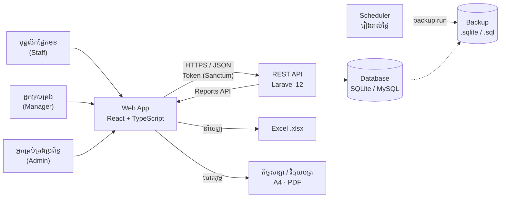
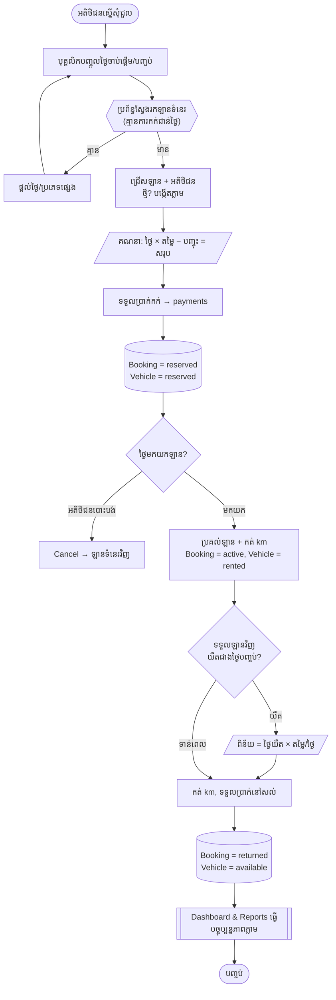
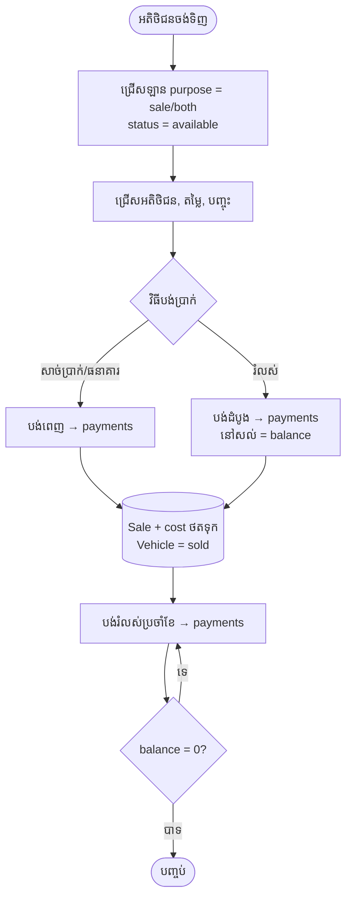
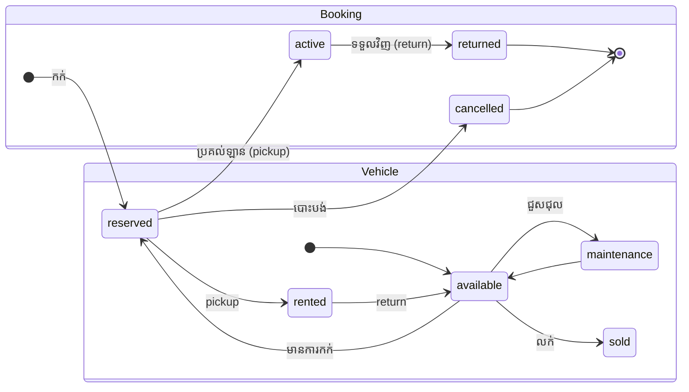
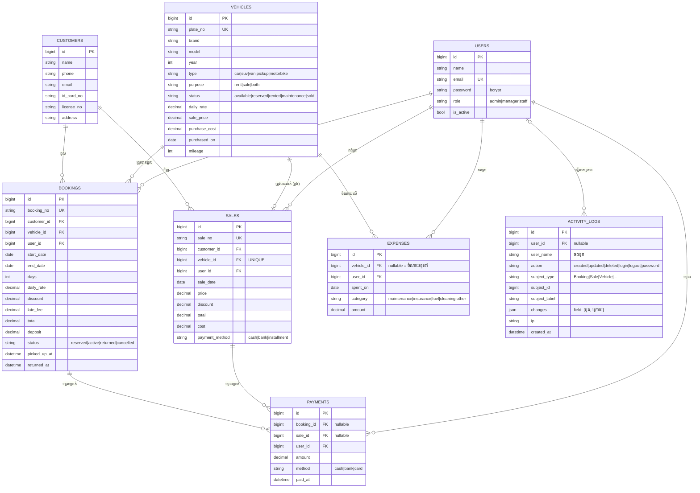

# ផ្នែកទី ២ · គម្រោងរចនាប្រព័ន្ធ (System Design Project)

**ប្រព័ន្ធ៖** Vehicle Sales & Rental System — Mekong Wheels
**បច្ចេកវិទ្យា៖** Laravel 12 (PHP, REST API) · React 19 + TypeScript (Web) · SQLite (ឬ MySQL)

> ដ្យាក្រាមខាងក្រោមសរសេរជា **Mermaid** — បើកក្នុង GitHub ឬ VS Code (Markdown Preview Mermaid)។
> **រូបភាព PNG សម្រាប់ដាក់ក្នុង Word/PDF/Slide** មាននៅ [docs/diagrams/](diagrams/)៖
> [Architecture](diagrams/02-1-architecture.png) · [Flowchart ការជួល](diagrams/02-2-rental-flowchart.png) · [Flowchart ការលក់](diagrams/02-3-sale-flowchart.png) · [State diagram](diagrams/02-4-booking-states.png) · [ERD](diagrams/02-5-erd.png)

---

## ២.១ ស្ថាបត្យកម្មប្រព័ន្ធ (Architecture)

| ស្រទាប់ | តួនាទី | ឯកសារសំខាន់ |
|---|---|---|
| Presentation | អេក្រង់ ៩: Dashboard, ការជួល, ការលក់, យានយន្ត, អតិថិជន, ចំណាយ, របាយការណ៍, អ្នកប្រើ, កំណត់ហេតុសកម្មភាព + ទំព័របោះពុម្ព | `frontend/src/pages/*` |
| Business logic | ច្បាប់អាជីវកម្ម (កក់ជាន់គ្នា, ពិន័យយឺត, ស្ថានភាពឡាន, សិទ្ធិ), កត់ត្រា audit log | `backend/app/Http/Controllers/Api/*`, `backend/app/Models/*` |
| Data | ៦ តារាងស្នូល + users + activity_logs | `backend/database/migrations/*` |
| ប្រតិបត្តិការ | Backup ប្រចាំថ្ងៃ, លុប token ផុតកំណត់ | `backend/routes/console.php`, `backend/app/Console/Commands/*` |

---

## ២.២ គំនូសតាងលំហូរប្រព័ន្ធ (System Flowchart) — ការជួលឡាន

### លំហូរការលក់ឡាន

### ដ្យាក្រាមស្ថានភាព (State diagram)

---

## ២.៣ ការរចនាមូលដ្ឋានទិន្នន័យ (Database Design) — ERD

### វចនានុក្រមទិន្នន័យ (Data Dictionary) — ចំណុចសំខាន់

| តារាង | ចំនួនជួរ (ទិន្នន័យគំរូ) | គោលបំណង | ច្បាប់/កំណត់សម្គាល់ |
|---|---|---|---|
| `customers` | ៨៤ | អតិថិជនជួល/ទិញ | ទូរស័ព្ទ ចាំបាច់; លុបមិនបាន បើមានប្រវត្តិ |
| `vehicles` | ៥៩ | យានយន្តទាំងអស់ (ជួល + លក់) | `plate_no` មិនស្ទួន; `purchase_cost` ប្រើគណនា ROI |
| `bookings` | ~២,២០០ | ប្រតិបត្តិការជួល (TPS) | `days = end − start + 1`; `total = days × rate − discount + late_fee`; មិនអនុញ្ញាតជាន់ថ្ងៃ |
| `sales` | ១៨ | ប្រតិបត្តិការលក់ | `vehicle_id` UNIQUE (ឡានលក់បានម្តង); `cost` ថតទុកពេលលក់ ដើម្បីចំណេញត្រឹមត្រូវ |
| `payments` | ~៤,០០០ | ប្រាក់ចូលគ្រប់ប្រភេទ | ភ្ជាប់ booking **ឬ** sale; មិនអនុញ្ញាតបង់លើស balance |
| `expenses` | ~៦០០/ឆ្នាំ | ចំណាយ (COSTS) | `vehicle_id` NULL = ចំណាយទូទៅ (ជួលការិយាល័យ, ភ្លើង) |
| `users` | ៤ | បុគ្គលិក និងសិទ្ធិ | ពាក្យសម្ងាត់ bcrypt (យ៉ាងតិច ៨ តួ); ត្រូវមាន admin យ៉ាងតិច ១; បិទគណនី → ចេញពីគ្រប់ឧបករណ៍ |
| `activity_logs` | កើនឡើងតាមការប្រើ | Audit trail៖ អ្នកណាធ្វើអ្វី ពេលណា | សរសេរតែម្យ៉ាង (append-only); `changes` = តម្លៃមុន/ក្រោយ; **មិនដែល** រក្សាពាក្យសម្ងាត់; `user_name` ថតទុក ដើម្បីនៅតែអានបាន ទោះអ្នកប្រើត្រូវលុប |

**តម្លៃដែលគណនា (derived, មិនរក្សាទុក)៖** `paid = SUM(payments.amount)`, `balance = total − paid`, `utilization = rented_days ÷ available_days`, `ROI = (rental revenue − expenses) ÷ purchase_cost`។

**Normalization៖** តារាងទាំងអស់ស្ថិតក្នុង **3NF** — ព័ត៌មានអតិថិជន/ឡាន រក្សាតែមួយកន្លែង ហើយការកក់/លក់យោងតាម foreign key។ ករណីលើកលែងដោយចេតនា៖ `bookings.daily_rate` និង `sales.cost` ថតតម្លៃ *ពេលប្រតិបត្តិការ* ដើម្បីកុំឲ្យការកែតម្លៃឡានពេលក្រោយ ប្តូរប្រវត្តិ។ ដូចគ្នានេះ `activity_logs.user_name` និង `subject_label` ថតទុកដោយចេតនា ព្រោះ audit log ត្រូវបង្ហាញស្ថានភាព *ពេលនោះ* មិនមែនស្ថានភាពបច្ចុប្បន្នទេ។ `subject_type` + `subject_id` ជា polymorphic reference (គ្មាន FK) ដូច្នេះកំណត់ហេតុនៅតែមាន ទោះកំណត់ត្រាដើមត្រូវលុប។

---

## ២.៤ តួនាទី និងសិទ្ធិ (Roles)

| មុខងារ | Staff | Manager | Admin |
|---|:-:|:-:|:-:|
| Dashboard, ការជួល, ការលក់, អតិថិជន (បន្ថែម/កែ) | ✅ | ✅ | ✅ |
| មើលបញ្ជីឡាន | ✅ | ✅ | ✅ |
| បន្ថែម/កែ/ជួសជុល ឡាន, ចំណាយ, មើលថ្លៃដើម/ចំណេញ | — | ✅ | ✅ |
| របាយការណ៍ & ការសម្រេចចិត្ត (DSS), នាំចេញ Excel | — | ✅ | ✅ |
| បោះពុម្ពកិច្ចសន្យាជួល / វិក្កយបត្រលក់ | ✅ | ✅ | ✅ |
| ប្តូរពាក្យសម្ងាត់ខ្លួនឯង | ✅ | ✅ | ✅ |
| លុបការលក់, លុបអតិថិជន | — | ✅ | ✅ |
| គ្រប់គ្រងអ្នកប្រើ, មើលកំណត់ហេតុសកម្មភាព (audit log) | — | — | ✅ |

## ២.៥ API សង្ខេប

| Method | Endpoint | មុខងារ |
|---|---|---|
| POST | `/api/auth/login` | ចូលប្រព័ន្ធ → token |
| GET | `/api/dashboard` | KPI ថ្ងៃនេះ |
| GET | `/api/vehicles/available?start_date&end_date` | ឡានទំនេរ |
| POST | `/api/bookings` | កក់ (ពិនិត្យជាន់ថ្ងៃ) |
| POST | `/api/bookings/{id}/pickup` · `/return` · `/cancel` · `/pay` | វដ្តការជួល |
| POST | `/api/sales` · `/api/sales/{id}/pay` | លក់ / បង់រំលស់ |
| GET | `/api/reports/performance?from&to` | DSS តាមប្រភេទឡាន |
| PUT | `/api/auth/password` | ប្តូរពាក្យសម្ងាត់ខ្លួនឯង (ឧបករណ៍ផ្សេងត្រូវចេញ) |
| GET | `/api/company` | ព័ត៌មានក្រុមហ៊ុន សម្រាប់បោះពុម្ព |
| GET | `/api/activity?user_id&action&subject_type&from&to&search` | Audit log (Admin) |

ការធ្វើតេស្ត៖
- Backend `backend/tests/Feature/` — ២៧ test៖ `RentalFlowTest` (កក់ជាន់គ្នា, ពិន័យយឺត, បង់លើស, លក់ពីរដង, សិទ្ធិ, ចំណាត់ថ្នាក់ DSS) និង `ProductionReadinessTest` (ពាក្យសម្ងាត់, គណនីបិទ, audit log, backup, production seed, security headers)
- Frontend `frontend/src/**/*.test.ts(x)` — ការគណនាថ្ងៃ/ប្រាក់, ការបកប្រែ ខ្មែរ/English, សមាសភាគ UI (`npm test`)
