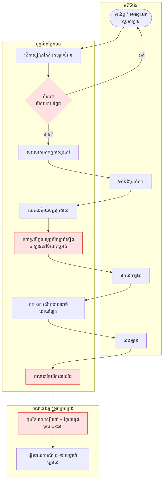
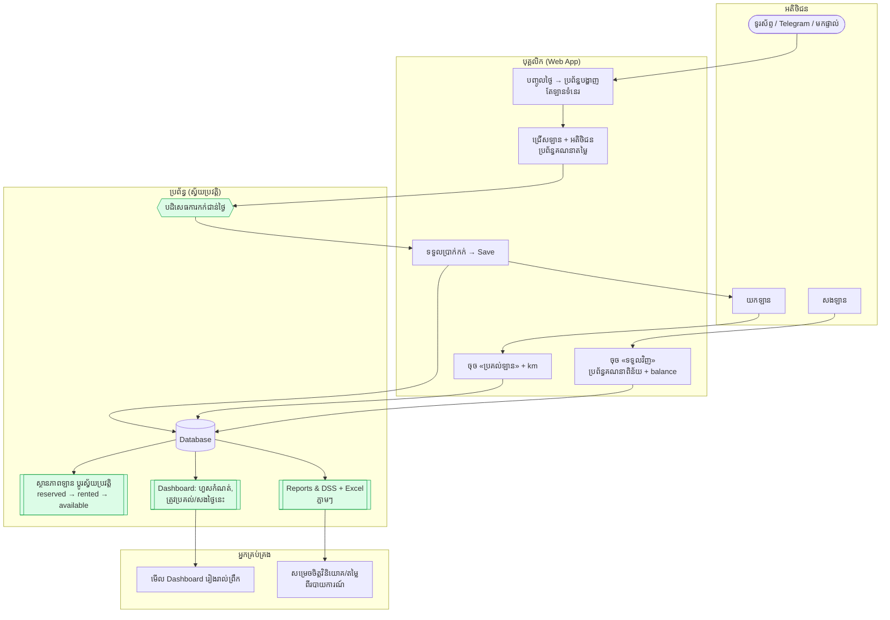

# ផ្នែកទី ៥ · ការគូសផែនទីដំណើរការអាជីវកម្ម (Business Process Mapping)

**ឧទាហរណ៍៖** ការកក់ដោយដៃ (Manual booking) → ប្រព័ន្ធស្វ័យប្រវត្តិ (Automated system)

---

## ៥.១ ដំណើរការបច្ចុប្បន្ន “As-Is” (ដោយដៃ)

### ចំណុចខ្សោយ (ប្រអប់ក្រហម)

| ជំហាន | បញ្ហា |
|---|---|
| ពិនិត្យឡានទំនេរដោយភ្នែក | កក់ជាន់គ្នា, យឺត ៥–១០ នាទី |
| ហៅសួរថាឡាននៅឬអត់ | គ្មានស្ថានភាពឡានពិតប្រាកដ |
| គណនាថ្ងៃយឺតដោយដៃ | ភ្លេចគិតពិន័យ, ជម្លោះ |
| វាយទិន្នន័យម្តងទៀតចុងខែ | ស្ទួនការងារ, កំហុស, របាយការណ៍យឺត |

**សរុប As-Is៖** ៩ ជំហានដោយដៃ · ឯកសារ ៣–៤ កន្លែង · ពេលកក់ ~១០ នាទី · របាយការណ៍ ១–២ សប្តាហ៍

---

## ៥.២ ដំណើរការថ្មី “To-Be” (ជាមួយ MIS)

---

## ៥.៣ ប្រៀបធៀប As-Is និង To-Be

| ទិដ្ឋភាព | As-Is (ដោយដៃ) | To-Be (MIS) | ការកែលម្អ |
|---|---|---|---|
| ពិនិត្យឡានទំនេរ | រកក្នុងសៀវភៅ | ប្រព័ន្ធបង្ហាញភ្លាម | ១០ នាទី → < ៣០ វិនាទី |
| ការកក់ជាន់គ្នា | កើតមាន | ប្រព័ន្ធបដិសេធ | 0 ករណី |
| ស្ថានភាពឡាន | ហៅសួរ | ពណ៌ (ទំនេរ/កក់/ជួល/ជួសជុល/លក់) | ពេលវេលាពិត |
| ពិន័យយឺត | គណនាដោយដៃ / ភ្លេច | ស្វ័យប្រវត្តិ (ថ្ងៃយឺត × តម្លៃ) | មិនបាត់ចំណូល |
| ការបង់ប្រាក់/ជំពាក់ | ក្រដាសច្រើនកន្លែង | paid / balance គ្រប់ការកក់ | ច្បាស់លាស់ |
| ការបញ្ចូលទិន្នន័យ | ២–៣ ដង | ១ ដង (single source of truth) | −66% ការងារ |
| របាយការណ៍ | ចុងខែ, ១–២ សប្តាហ៍ | ភ្លាមៗ + Excel | ពេលវេលាពិត |
| ការសម្រេចចិត្ត | អារម្មណ៍ | ROI, អត្រាប្រើប្រាស់, ពិន្ទុ | ផ្អែកលើទិន្នន័យ |
| សុវត្ថិភាព | អ្នកណាក៏កែបាន | Login + តួនាទី | មានការគ្រប់គ្រង |

## ៥.៤ ជំហានបន្ទាប់ (To-Be ដំណាក់កាលទី ២)

1. **កក់តាមអនឡាញដោយអតិថិជនផ្ទាល់** (website/Telegram bot) ប្រើ API `/vehicles/available` ដដែល
2. **ទូទាត់ ABA KHQR** ភ្ជាប់ទៅតារាង payments ស្វ័យប្រវត្តិ
3. **សាររំលឹក** ១ ថ្ងៃមុនថ្ងៃសងឡាន និងពេលហួសកំណត់
4. **កាលវិភាគថែទាំ** ផ្អែកលើ km (ឧ. រៀងរាល់ ៥,០០០ km)
